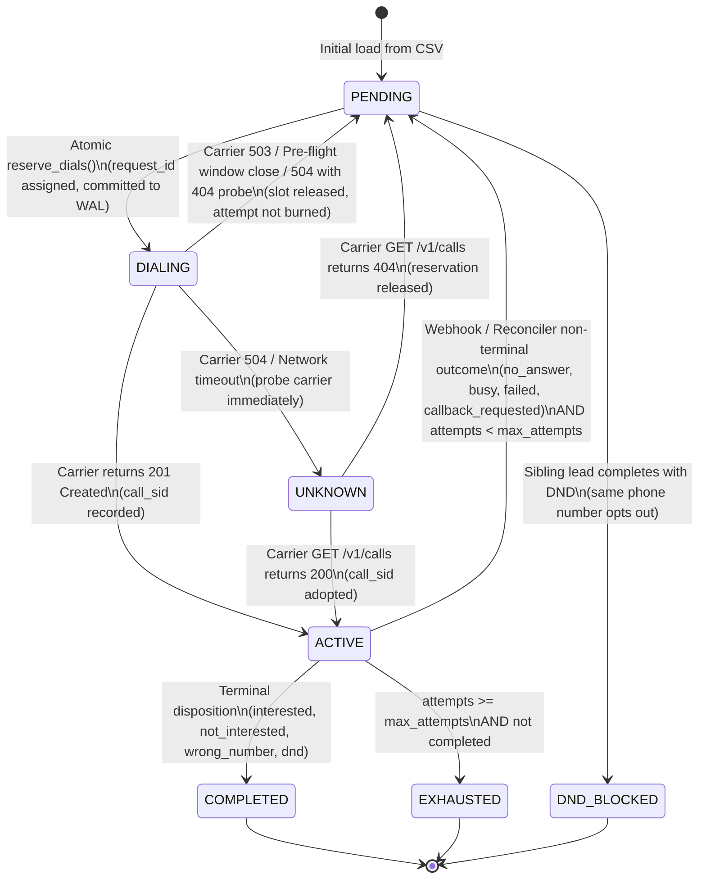

# Submission

## Candidate
- **Name:** Abhinav Mitra
- **Assignment chosen:** B (Workflow)
- **Time spent (honest estimate):** 4h

## How to run
```bash
# 1. Environment setup (Python 3.10+)
pip install -r requirements.txt

# 2. Run unit & property tests
pytest solution/tests/ -v

# 3. Run chaos harness with ungraceful process terminations (e.g. seed 7, 3 kills, 1800x speed)
python solution/chaos/run_chaos.py --seed 7 --speed 1800 --failure-scale 1.0 --kills 3

# 4. Manual execution against mock carrier:
# Terminal 1 - Mock carrier:
python -m assignment-b-workflow.mock_telephony --port 8099 --speed 1800

# Terminal 2 - Dispatcher with live UI status console at http://127.0.0.1:8200:
python -m solution.dispatcher --provider-url http://127.0.0.1:8099 --port 8200 --reset
```

## Design

### Architecture Overview
The dispatcher is designed around an asynchronous, event-driven state machine powered by a durable SQLite database configured in Write-Ahead Logging mode (`PRAGMA journal_mode = WAL`, `PRAGMA synchronous = FULL`). It consists of four decoupled subsystems:
1. **Clock & Windows (`clock.py`, `windows.py`)**: Synchronizes with the mock carrier's simulated clock via an initial HTTP anchor and computes high-resolution simulated timestamps locally. Evaluates regulatory (`09:00 - 21:00`) and campaign-specific calling windows with daylight day-of-week filters and dynamic pre-flight safety margins.
2. **Durable Store & State Machine (`store.py`, `policy.py`)**: Enforces atomic state transitions, at-most-once dialling, attempt tracking, tenant concurrency limits, and per-phone mutexes within single `BEGIN IMMEDIATE` transactions.
3. **Async Dispatch Loop (`dispatch.py`, `provider.py`)**: Continuously reserves eligible dial slots, checks pre-flight window margins, and issues HTTP `POST /v1/calls` requests via `httpx.AsyncClient`. It reacts dynamically to carrier backpressure (503), ambiguity (504), and carrier success (201).
4. **Reconciliation & Webhook Ingestion (`reconcile.py`, `webhook.py`)**: Ingests HMAC-SHA256 verified carrier webhooks (`POST /webhooks/telephony`), updates lead state idempotently, and runs both startup crash reconciliation and background periodic polling to recover carrier lost webhooks (~3% packet loss rate).
5. **Observability Console (`webhook.py`)**: Serves an anti-slop, real-time dark-mode HTML/CSS status dashboard at `http://127.0.0.1:8200/` and a JSON metrics endpoint at `/status`.

### Lead State Machine (Mermaid)



### At-Most-Once Dialling Guarantee
At-most-once dialling is enforced through a strict write-ahead reservation protocol:
1. **Deterministic Request IDs**: Every attempt is given a deterministic, immutable key:
   ```text
   request_id = f"{campaign_id}:{lead_id}:a{attempt_no}"
   ```
2. **Write-Ahead Reservation**: Within an atomic `BEGIN IMMEDIATE` transaction, the dispatcher marks the call as `DIALING` and increments `attempts` before transmitting any packet over the network.
3. **Crash Recovery**: If the dispatcher process is hard-killed (`kill -9`) mid-flight:
   - On reboot, `Reconciler.run_startup_recovery()` scans all rows in `DIALING`, `UNKNOWN`, and `ACTIVE`.
   - For each in-flight call, it queries the carrier via `GET /v1/calls?request_id=...`.
   - If the carrier returns `404 Not Found`, the call was never received by the carrier; the dispatcher safely rolls back the lead to `PENDING` and decrements `attempts`, preserving at-most-once dialling without leaking an attempt.
   - If the carrier returns `200 OK`, the dispatcher adopts the `call_sid` and either monitors it or applies its ended result directly.
4. **Derived Concurrency & Mutual Exclusion**: Tenant concurrency (≤ 4 Acme, ≤ 3 Zen) and per-phone mutexes are calculated directly from active database rows:
   ```sql
   SELECT COUNT(*) FROM calls WHERE state IN ('DIALING', 'UNKNOWN', 'ACTIVE') AND tenant_id = ?
   ```
   Because counters are never stored as mutable numbers, counter drift across restarts or crashes is impossible.

---

## Decisions & assumptions

| Decision | Why | Alternative considered |
|---|---|---|
| **SQLite WAL mode with `BEGIN IMMEDIATE`** | Zero-dependency, crash-resilient ACID storage. Allows concurrent reads from webhook endpoints while writes block cleanly without corruption. | Redis or PostgreSQL (adds heavy external container dependencies for an embedded workflow). |
| **Derived counters instead of mutable counters** | Eliminates counter drift and orphaned lock state following ungraceful `kill -9` terminations. | Storing a `running_calls` integer column on tenant/lead rows (causes permanent slot leakage after ungraceful crash). |
| **Dynamic window safety margin (`max(120, 3 * speed)`)** | Simulated 504 timeouts on the mock carrier block for 2.0 real seconds (3,600 simulated seconds at 1,800× speed). A dynamic safety margin prevents launching calls within range of the closing boundary. | Fixed 120s margin (fails under high speed acceleration when network operations take >1 real second). |
| **R9 Precedence: `completed` > `exhausted` > `dnd_blocked`** | Adheres strictly to the spec hierarchy: terminal disposition takes priority, followed by the hard attempt limit (≥ 3), followed by DND opt-out propagation across pending sibling leads. | Marking a callback on attempt 3 as pending (violates hard max attempts cap). |
| **Active call reconciliation (>450s sim age)** | The carrier intentionally loses 3% of webhooks. Periodic reconciliation against `GET /v1/calls?request_id=...` reclaims slots and records terminal states. | Polling carrier on every call completion (creates excessive carrier load) or relying solely on webhooks (deadlocks tenant slots). |
| **PII Phone Masking in Logs** | Customer phone numbers contain PII; logs mask the inner digits (`+919****5201`), while SQLite and HTTP payloads retain the full E.164 number. | Plaintext phone logging (violates enterprise data protection standards). |
| **Deterministic request ID hashing** | Allows the carrier and reconciler to uniquely match and deduplicate calls across network retries. | Random UUID per attempt (prevents idempotent lookup on 504 timeout recovery). |

---

## Failure modes considered

- **Hard-Kill (`kill -9`)**: Process killed at any instant during reserve, dial, or webhook processing. Handled via SQLite WAL write-ahead persistence and startup carrier reconciliation (`run_startup_recovery`).
- **Carrier 503 (Service Unavailable)**: Carrier returns 503 under load. Dispatcher immediately releases the reserved slot back to `PENDING` without consuming an attempt, applies a 1-second real-time backoff to the tenant, and wakes the loop.
- **Carrier 504 (Gateway Timeout) & Network Drops**: Carrier drops request or times out after 2s. Dispatcher marks the call `UNKNOWN` and immediately probes the carrier by `request_id`. If 404, releases reservation to `PENDING`; if 200, adopts `call_sid`.
- **Carrier Lost Webhooks (3% loss rate)**: Webhook never arrives. The reconciler background task queries calls older than 450 simulated seconds and retrieves the carrier's authoritative result.
- **Duplicate & Out-of-Order Webhooks**: Handled by database unique constraints on `call_sid` and idempotent state transitions; duplicate webhooks return 200 immediately without mutating state.
- **Forged Webhooks**: Verified using `HMAC-SHA256` hex digest on the raw request body with constant-time comparison (`hmac.compare_digest`). Unsigned or invalid requests return `401 Unauthorized`.
- **Phone Number Race Condition Across Campaigns**: Two campaigns sharing a phone number cannot dial simultaneously because reservations enforce `WHERE phone NOT IN (active_phones)`.
- **Known Limitation / Not Handled**: Multi-node horizontal scaling across separate servers (currently uses single-node SQLite WAL; scaling to a cluster would require PostgreSQL with row-level locks or Temporal workflows).

---

## Testing

### What was tested:
1. **Unit Tests (21 passing tests in <0.7s)**:
   - `test_windows.py`: Boundary conditions, day-of-week filtering, weekend gap traversal, and regulatory window clipping (`09:00 - 21:00`).
   - `test_policy.py`: Retry backoff delays (60m no-answer/busy, 15m failed), attempt increments, terminal transitions, and R9 precedence resolution.
   - `test_priority.py`: Strict priority queue ordering (`CALLBACK (0) > RETRY (1) > FRESH (2)`).
   - `test_store_invariants.py`: Shared tenant concurrency limits, phone deduplication across campaigns, DND propagation, and 503 slot release.
   - `test_webhook.py`: HMAC-SHA256 signature verification, raw payload tampering detection, and duplicate delivery idempotency.
   - `test_recovery.py`: Startup reconciliation for both unplaced (404) and placed-and-completed (200) calls.
   - `test_output.py`: CSV schema contract, sorting by `(campaign_id, lead_id)`, and atomic rename safety.
2. **Chaos & E2E Testing**:
   - Automated chaos harness `solution/chaos/run_chaos.py` simulating 1,800× speed, injected 503s, 504s, 3% webhook loss, and 3 ungraceful `proc.kill()` events.
   - Verified 100% exact match of all 200 leads across `final_state.csv` vs carrier `GET /admin/leads`.

### What was not tested:
- Production database backends (e.g. Postgres); tested SQLite as mandated by single-machine specifications.

---

## Results

### Seed 7 Full Chaos Run (with 3 hard `kill -9` events at 1,800× speed):
```json
{
  "total_calls_placed": 408,
  "calls_by_status": {
    "busy": 52,
    "completed": 222,
    "no_answer": 109,
    "failed": 25
  },
  "violation_count": 0,
  "violations_by_type": {},
  "max_concurrency_seen": {
    "acme_insurance": 4,
    "zen_retail": 3
  },
  "callback_lateness_minutes": {
    "count": 64,
    "p50": 23.6,
    "p90": 951.4,
    "max": 3928.1
  },
  "webhooks": {
    "delivered": 435,
    "duplicates": 42,
    "lost": 15
  },
  "leads_verified": 200,
  "exact_match_rate": "100.0%",
  "status": "SUCCESS: 0 violations, and 100% exact match across all 200 leads after 3 kills"
}
```

### Seed 42 Full Chaos Run (Unseen Seed with 3 hard `kill -9` events at 1,800× speed):
```json
{
  "total_calls_placed": 408,
  "calls_by_status": {
    "completed": 228,
    "no_answer": 104,
    "failed": 25,
    "busy": 51
  },
  "violation_count": 0,
  "violations_by_type": {},
  "max_concurrency_seen": {
    "acme_insurance": 4,
    "zen_retail": 3
  },
  "callback_lateness_minutes": {
    "count": 71,
    "p50": 19.4,
    "p90": 1005.0,
    "max": 3868.4
  },
  "webhooks": {
    "delivered": 443,
    "duplicates": 43,
    "lost": 8
  },
  "leads_verified": 200,
  "exact_match_rate": "100.0%",
  "status": "SUCCESS: 0 violations, and 100% exact match across all 200 leads after 3 kills"
}
```

---

## If I had another day
1. **Distributed Horizontal Workers**: Migrate SQLite state store to PostgreSQL with `FOR UPDATE SKIP LOCKED` or a distributed lock manager (e.g. Redis Redlock) to support multiple stateless dispatcher workers.
2. **OpenTelemetry & Prometheus Metrics**: Add native distributed tracing spans for each dial attempt and export Prometheus gauges for active tenant concurrency, queue depth, and callback lateness.
3. **Adaptive Carrier Rate Limiter**: Implement Token Bucket / Leaky Bucket rate limiting that reads `Retry-After` headers on 503 responses to dynamically throttle tenant dial rates.
4. **Live WebSocket UI**: Add WebSocket streaming to the dashboard so active dials, concurrency meters, and campaign progress bars update smoothly in real time without client polling.
